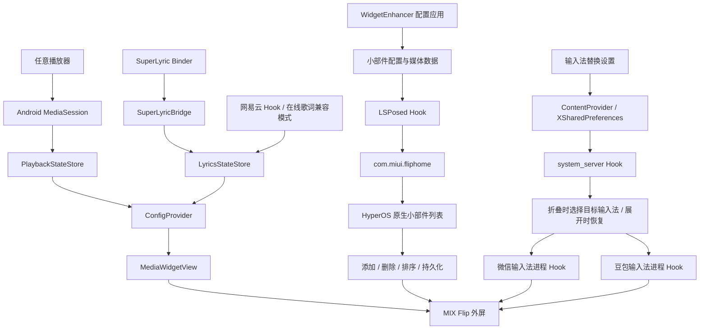

<div align="center">

# WidgetEnhancer

为 **Xiaomi MIX Flip 外屏**扩展自定义小部件与第三方输入法适配能力的 LSPosed 模块

[](https://github.com/luckylca/WidgetEnhancer/releases/latest)
[](LICENSE)
[](https://github.com/LSPosed/LSPosed)

</div>

WidgetEnhancer 将自定义小部件直接接入 HyperOS 原生外屏小部件系统。创建后的小部件会出现在系统的「外屏 → 小部件 → 自定义」中，可以像官方小部件一样添加、删除、排序和使用。

> [!IMPORTANT]
> 本模块面向 **Xiaomi MIX Flip**，需要 Root、LSPosed 和 HyperOS 外屏桌面 `com.miui.fliphome`。

## 功能

### 媒体小部件

在外屏展示图片或循环视频。

- 支持图片和视频
- 支持裁剪、缩放和位置调整
- 按照外屏比例生成预览
- 视频支持循环播放

### 音乐小部件

**基于 Android MediaSession + SuperLyric + 在线歌词兼容模式的多播放器音乐小部件**，显示当前播放信息、封面、进度和同步歌词。

- MediaSession 提供歌曲标题、歌手、专辑、封面、播放进度和播放控制
- SuperLyric 提供同步歌词、翻译、罗马音，以及部分播放器的逐字时间
- 在线歌词兼容模式可仅根据 MediaSession 的歌名、歌手和时长搜索整首歌词，不依赖 SuperLyric
- 外屏显示上一句、当前句和下一句；原有歌词小部件布局保持不变
- 网易云音乐保留现有 Hook 与在线歌词 fallback

SuperLyric 可用时优先使用其同步歌词；未安装 SuperLyric、当前播放器未适配或暂时没有歌词时，可开启在线歌词兼容模式作为兜底。只要音乐客户端能够正常向 Android MediaSession 暴露歌曲信息，理论上都可以尝试匹配在线歌词，因此兼容范围不再局限于特定播放器。

歌词可用性仍取决于歌曲元数据和在线歌词库的匹配质量。SuperLyric 当前列出的播放器包括 LX Music、网易云音乐、QQ 音乐、酷狗音乐及概念版、酷我音乐、Spotify、Apple Music、汽水音乐、椒盐音乐、MusicFree 和 Poweramp 等；部分播放器仅在特定页面或歌词模式下能提供歌词。请以 [SuperLyric 支持列表](https://github.com/HChenX/SuperLyric) 为准。

WidgetEnhancer 使用官方 SuperLyricApi 源码在自己的应用进程中接收歌词，不会把每个音乐播放器加入本模块的 LSPosed 作用域。

| 操作 | 功能 |
| --- | --- |
| 单击 | 播放 / 暂停 |
| 双击上半区域 | 上一首 |
| 双击下半区域 | 下一首 |
| 长按上半区域 | 增加音量 |
| 长按下半区域 | 降低音量 |

### 快捷按钮小部件

可以创建包含 **1～6 个按钮**的快捷小部件，按钮数量会自动匹配对应布局。

支持绑定应用以及常用系统操作，包括：

- 打开应用
- 音量控制与静音
- 手电筒
- 勿扰模式
- 自动旋转
- 锁屏
- 播放 / 暂停
- 上一首 / 下一首
- 部分快捷设置功能

### 通知小部件

在外屏同步显示最近的 **3 条通知**，每条显示应用图标、标题和内容。

| 操作 | 功能 |
| --- | --- |
| 单击通知 | 跳转对应应用 |
| 左滑通知 | 删除该通知 |

需要授予通知使用权，该权限也用于媒体会话读取。

### 小爱课程表

直接从手机上的小米小爱语音助手读取课程表本地数据，并用更清晰的课程卡片显示本周课程。

- 添加类型后无需粘贴分享链接或设置学期日期
- 首次使用时，在小米小爱语音助手中打开一次课程表
- 自动读取课程名称、节次、时间、教室、教师和当前周次
- 课程数据只通过本机进程间桥接并缓存在本机
- 在 LSPosed 中启用本模块对 `com.miui.voiceassist` 的作用域

### 应用小部件

提供一整页 **2 × 3 网格**，可以自由摆放手机应用提供的 Android AppWidget。

- 支持 1×1、2×1、1×2、2×2、1×3、2×3 槽位
- 支持按住拖动调整位置
- 点按槽位可调整尺寸、圆角或删除
- 支持小部件自身点击和滚动交互
- 首次使用时按系统提示完成 AppWidget 授权
- 支持直接打开系统桌面小部件面板，选择后直接加入当前外屏布局

### ZIP / MAML 小部件

支持导入外部 `.zip` / `.mtz` MAML 小部件包，例如从主题商店提取的 2×3 小部件。

- 可作为系统原生 MAML 小部件导入
- 也可加入 2 × 3 应用小部件页面进行混合布局
- 由 FlipHome 原生 MAML 宿主渲染
- 支持读取系统桌面已经缓存的 MAML 小部件，并通过预览图直接导入

### 小部件管理

模块自带配置应用，可以直接管理外屏小部件：

- 创建、编辑和删除
- 重命名
- 启用 / 禁用
- 实时预览
- 导入小部件

创建完成后，进入：

```text
设置 → 外屏 → 小部件 → 自定义
```

即可将其添加到外屏。

### 外屏输入法适配

在「我的外屏」设置中，可以选择微信输入法或豆包输入法作为折叠状态下的外屏输入法。两个开关共用同一个替换目标，同一时间只会启用其中一种；展开后恢复原来的内屏输入法。

- **微信输入法**：适配外屏键盘窗口与镜头区域，针对九宫格键盘宽度、符号键盘和长按弹出布局进行调整；展开后恢复原来的内屏布局。
- **豆包输入法**：适配外屏窗口与镜头侧区域，调整候选工具栏宽度和横向位置，并在屏幕旋转或展开时恢复原始布局。
- 输入法切换由 `system_server` 侧处理；键盘窗口和布局适配在对应输入法进程内执行。
- 该功能依赖 HyperOS 内部实现及输入法自身的类结构，系统或输入法升级后可能需要重新适配。

## 实现原理

WidgetEnhancer 基于 **LSPosed / Xposed Hook** 实现，功能分布在外屏桌面、系统服务和输入法进程中：

- `com.miui.fliphome`：注入自定义小部件，并接入 HyperOS 原有的小部件管理和运行时。
- `android` / `system_server`：处理折叠状态下的输入法选择，以及 FlipHome 的 AppWidget 绑定授权。
- `com.tencent.wetype`：适配微信输入法的外屏窗口和键盘布局。
- `com.bytedance.android.doubaoime`：适配豆包输入法的外屏窗口和候选工具栏。



因此，小部件的添加、删除、排序、页面管理和持久化会尽可能继续使用 HyperOS 原有逻辑，模块主要负责自定义小部件的数据、配置与显示内容。

## 兼容性

当前主要适配 **Xiaomi MIX Flip（ruyi）+ HyperOS**。

当前仓库构建版本为 **WidgetEnhancer 0.9.11（versionCode 35）**。微信输入法基础适配以 **微信输入法 4.0.0（versionCode 58201）** 为实机验证基线；近期代码继续调整九宫格宽度、符号键盘和长按弹出布局，发布前应在对应设备上完成回归。豆包输入法已加入独立适配，当前未声明经过完整验证的版本范围。

模块使用了 HyperOS 和输入法内部类及方法。系统 OTA、输入法升级或目标应用内部实现变化，都可能影响对应 Hook；不同功能的兼容性也需要分别验证。

## LSPosed 作用域

### 必选：外屏桌面

```text
com.miui.fliphome
```

这是自定义小部件注入、目录管理和运行时渲染的主要 Hook 目标。

### 系统服务：输入法切换与 AppWidget 授权

```text
system
```

用于在 `system_server` 中处理折叠状态下的输入法选择，并为 FlipHome 处理 AppWidget 绑定授权。新版 LSPosed 通常显示为 `system`；如果旧版管理器没有该条目，请勾选 `android`。

### 按需启用：外屏输入法

微信输入法：

```text
com.tencent.wetype
```

豆包输入法：

```text
com.bytedance.android.doubaoime
```

在「我的外屏」设置中选择其中一种输入法作为折叠状态下的替换输入法，并启用对应的 LSPosed 作用域。两个设置开关共用一个替换目标，不会同时选择两种输入法。微信输入法进程作用域还负责其键盘窗口、九宫格、符号键盘和长按布局适配；豆包输入法进程作用域负责其窗口和候选工具栏适配。

输入法替换设置可以先保存，作用域是否真正生效仍取决于 LSPosed 是否加载了相应进程。当前微信输入法设置页会显示 system 和微信进程的启动回报；豆包进程尚未接入同样的独立状态回报。

外屏输入法适配参考了 [MixFlipMod](https://github.com/parallelcc/MixFlipMod) 的机型思路，以及 [MIUI_IME_Unlock](https://github.com/RC1844/MIUI_IME_Unlock) 的全面屏键盘支持方式。

### 可选：导入外屏缓存小部件

```text
com.miui.home
```

用于读取 `com.miui.home/files/maml/res/0/` 中已缓存的 MAML 小部件，并在编辑应用小部件格子时显示包内预览图供选择。

### 可选：系统桌面小部件面板

```text
com.miui.personalassistant
```

用于直接打开 HyperOS 系统桌面的小部件选择面板，并把选中的 AppWidget / MAML 小部件回传到 WidgetEnhancer。

### 可选：小爱课程表

```text
com.miui.voiceassist
```

用于从小米小爱语音助手进程读取本地课程表数据。

### 可选：网易云音乐

```text
com.netease.cloudmusic
```

保留网易云歌词 Hook fallback。SuperLyric 自己负责播放器适配；WidgetEnhancer 不需要把 LX Music、QQ 音乐、Spotify 等作用域加入本模块。

### 可选：SystemUI

```text
com.android.systemui
```

用于部分高级快捷设置功能。不使用相关功能时无需勾选。

模块自身应用 `com.lucky.mixflipouter` 不依赖 Xposed Hook 运行，不需要为了打开配置应用而单独启用该作用域。

## 安装

1. 从 [Releases](https://github.com/luckylca/WidgetEnhancer/releases/latest) 下载并安装 APK。
2. 在 LSPosed 中启用 WidgetEnhancer。
3. 至少勾选 `com.miui.fliphome`；需要系统输入法切换或 AppWidget 免授权绑定时，同时勾选 `system`（旧版 LSPosed 对应 `android`）。
4. 使用微信或豆包外屏输入法时，在设置中选择对应输入法，并分别勾选 `com.tencent.wetype` 或 `com.bytedance.android.doubaoime`；其它作用域按需启用：`com.miui.home`（读取 MAML 缓存）、`com.miui.personalassistant`（系统小部件面板）、`com.miui.voiceassist`（小爱课程表）、`com.netease.cloudmusic`（网易云歌词 fallback）和 `com.android.systemui`（部分高级快捷设置）。需要高质量通用同步歌词时可另行安装并启用 SuperLyric，也可以直接使用内置在线歌词兼容模式。
5. 重启手机。
6. 打开 WidgetEnhancer 创建小部件。
7. 进入「设置 → 外屏 → 小部件 → 自定义」添加小部件。

## 权限

部分功能需要额外系统权限：

| 权限 | 用途 |
| --- | --- |
| 通知使用权 | 获取媒体播放状态、音乐信息和最近通知 |
| 相机权限 | 控制手电筒 |
| 勿扰模式访问权限 | 控制勿扰模式 |
| 修改系统设置 | 控制自动旋转等系统功能 |
| AppWidget 系统授权 | 未启用 `android` 作用域时，首次添加第三方应用小部件需完成系统绑定授权 |

不使用对应功能时无需授予相关权限。

## 运行日志与诊断导出

模块 Hook 进程会把日志异步批量发送到独立的 `:logger` 接收进程，再统一写入模块私有的设备保护存储目录。队列和每批 IPC 均有字节数上限；当前 JSONL 文件上限为 5 MB，保留当前文件和最近 4 个轮转文件（最多约 25 MB）。`:logger` 会按事件 ID 去重，并区分接收、排队和已落盘状态；重要日志优先刷盘。服务或文件暂时不可用时，模块私有存储中的有界后备队列会在服务恢复后补写，同时保留最终丢失数量和原因。不申请公共存储权限。日志接收端按 UID、包名和实际进程名共同校验调用者，`system_server` 通过 UID 1000 单独校验。

在「设置 → 诊断」中可以查看最近运行日志，按等级和进程筛选，并点开记录查看异常堆栈。页面分别提供「导出日志」和「导出诊断包」：日志 ZIP 只包含原始 JSONL 文件和 `manifest.json`；完整诊断 ZIP 还包含 `diagnostics/environment.json`、`diagnostics/hook_status.json`、`diagnostics/report.json` 和相同时间点的日志快照。两种 ZIP 都在后台生成并固定一致的日志快照。

生成后可通过 Android 系统文件选择器保存 ZIP，也可通过原生分享面板发送。分享使用受限范围的 FileProvider `content://` URI 和读取授权；分享面板关闭或保存失败后，临时 ZIP 保留 24 小时以便重试，后续导出时清理过期文件。SAF 保存成功后会尽快删除临时 ZIP。manifest 记录导出时间、版本、文件大小、时间范围和读取状态；个别文件不可读时会列明原因并继续打包其他可读取日志。

诊断页会列出本次启动中已观察到模块加载回报的进程、未观察到回报的进程及其安装状态。LSPosed 不提供可由模块读取的完整作用域勾选状态，因此「尚未观察到」只表示本次启动没有收到进程回报，不代表能够确认作用域未勾选。Hook 注册结果和功能运行状态分别记录；可选 Hook 缺失会单独显示，不会自动把整个功能判为失败。

日志记录 Hook 安装结果、依赖和版本信息、关键功能状态变化以及异常堆栈；不会主动记录输入内容、通知正文、完整歌词或个人文件内容。通知小部件卡片自动跟随 Android 系统浅色/深色设置，不提供单独的主题开关；桌面壁纸上的其他文字和占位元素继续使用原有壁纸明暗适配。

## 签名与升级

从 **0.8.3** 开始，官方 Release 使用永久固定签名，后续版本会保持同一证书，可直接覆盖升级。

正式签名证书 SHA-256：

```text
996d10e602eb6e0a1cd8a3853128d6ce4d4e456078d93eb2ce27e655d9f89215
```

> [!IMPORTANT]
> 0.8.2 及更早版本由临时 CI Debug Key 签名，与 0.8.3 起的正式签名不同。因此从旧版升级到 0.8.3 时，需要最后一次卸载旧版后重新安装；从 0.8.3 开始后续版本可正常覆盖升级。

## 构建

```bash
git clone https://github.com/luckylca/WidgetEnhancer.git
cd WidgetEnhancer
./gradlew assembleRelease
```

构建产物位于：

```text
app/build/outputs/apk/release/
```

## 开源协议

WidgetEnhancer 使用 **GNU General Public License v3.0（GPL-3.0）** 开源。

你可以在 GPL-3.0 条款下使用、修改和分发本项目。分发修改版本时，需要遵守 GPL-3.0 对源代码公开及许可证保留等要求。

完整协议请参阅 [LICENSE](LICENSE)。
